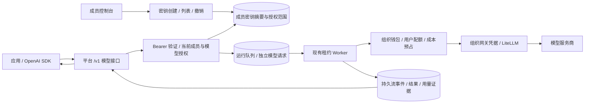

# 成员 API 密钥与模型服务

成员在当前组织的“资源与费用 → API 密钥”创建个人密钥，并通过平台地址调用模型。组织 owner、tenant_admin 和 member 可使用；finance_viewer 没有模型执行权限。密钥固定绑定创建时的组织、成员和成员权限版本，不随网页切换组织变化。

## 使用

1. 为组织授权模型、配置就绪网关并入账。成员调用与 Playground 共享组织余额、成员及组织配额、供应商成本预算。
2. 打开“API 密钥”，填写名称、有效期和可选模型范围。有效期为 1–365 天，默认 90 天；每人每组织最多 10 个未过期、未撤销的密钥。留空模型范围表示使用该组织当前及后续授权的可用模型。
3. 完整密钥只在创建响应中出现一次。列表只显示名称和部分标识；数据库保存 SHA-256 摘要，无法找回原文。页面关闭后清除完整密钥，页面不写入浏览器持久存储。
4. 将密钥保存到应用环境变量 `AGENT_PLATFORM_API_KEY`。Base URL 为平台域名后追加 `/v1`，本机是 `http://127.0.0.1:8010/v1`。模型 ID 使用 `/v1/models` 返回的 ID，即平台模型目录中的别名。

```python
import os
from openai import OpenAI

client = OpenAI(
    base_url="http://127.0.0.1:8010/v1",
    api_key=os.environ["AGENT_PLATFORM_API_KEY"],
    max_retries=0,
)
models = client.models.list()
model = models.data[0].id  # 按应用需求选择一个已授权模型

chat = client.chat.completions.create(
    model=model,
    messages=[{"role": "user", "content": "请用一句话说明什么是幂等。"}],
    max_completion_tokens=2048,
)
print(chat.choices[0].message.content)

response = client.responses.create(
    model=model,
    input="请用一句话说明什么是幂等。",
    max_output_tokens=2048,
    store=False,
)
print(response.output_text)
```

两种接口都接受 `stream=True`。Chat Completions 的 `stream_options={"include_usage": True}` 在最后返回累计用量并发送 `[DONE]`。Responses 使用具名 SSE 事件，包括 `response.created`、`response.output_text.delta`、`response.completed`，可使用 Python SDK 的 `responses.stream(...).get_final_response()` 累积结果。输出截断分别映射为 `finish_reason="length"` 和 `response.incomplete`，不自动追加付费请求。

## 第一版支持范围

| 接口 | 支持内容 |
| --- | --- |
| `GET /v1/models` | 当前密钥范围内、组织已启用且路由就绪的模型 |
| `POST /v1/chat/completions` | 文本消息、system/developer/user/assistant/tool、函数定义与调用历史；stream、temperature、reasoning_effort、max_tokens 或 max_completion_tokens、n=1、tool_choice=auto |
| `POST /v1/responses` | 字符串或文本 message input、instructions、function_call/function_call_output、函数定义；stream、temperature、reasoning.effort、max_output_tokens、store=false、tool_choice=auto |

函数由客户端执行；平台只返回函数名与参数，不执行自定义函数，即使与平台内置工具同名。函数参数在完整输出确认后发送，文本增量实时转发。不支持图片、音频、文件、内置联网工具、托管会话、`previous_response_id` 或 `store=true`；不支持的参数明确返回 422，避免静默丢弃用户要求。每个请求最多 100 条消息、16 个函数、256 KiB JSON。单次输出仍受模型和平台预算限制。

上下文由调用方提交，Responses 继续对话时提交完整 input 历史。`store=false` 表示不使用上游存储会话；平台仍保存隔离的请求内容和结果，沿用运行记录及组织内容保留期，便于成员追踪和账务核对。

## 权限、撤销与费用

- 个人密钥仅用于 `/v1` 模型服务；平台管理、密钥管理和会话管理仍要求网页登录与 CSRF 校验。密钥不能作为平台管理员身份使用。
- 每次入队、Worker 领取、模型准入和 HTTP 结果转发都检查当前密钥、成员资格与模型授权。成员被移除、停用或角色/权限版本变化后原密钥失效；重新加入不会恢复旧密钥。组织暂停或关闭同样禁止继续使用。
- 成员只能查看自己的密钥；管理员可通过 `GET .../api-keys?all_members=true` 查看本组织密钥元数据并撤销。任何人都无法再次查看完整密钥。
- 撤销不删除历史和账务。运行中撤销、断开调用连接后停止后续输出并请求取消；已发送的模型调用仍可能产生费用。未知用量保留预占并由现有后台补证流程核对。
- 同一成员创建多把密钥仍共享成员与组织限额。第一版不额外设置每把密钥的费用或 RPM 配额。密钥归属保存在运行快照 `api_key_id` 和 `model_api_requests.key_id`，调用统计沿用用户、模型、Token 和费用记录。
- HTTP 等待连接与入队原子准入，受现有 SSE 连接限额约束；拒绝连接不会留下付费任务。`Idempotency-Key` 在密钥内隔离，相同请求完成后返回原结果，改变请求返回 409，正在执行的重复请求返回 `request_in_progress`。不要为未知结果更换幂等标识进行盲目重试。

## 实现与部署



新增 `member_api_keys` 与 `model_api_requests`，启用 PostgreSQL FORCE RLS，加入每服务权限矩阵和组织内容清理。模型请求复用 `platform_runs`，`session_id=null`，不创建额外 Agent 或 Playground 会话。运行详情标记 `source=model_api`；原有调用和费用统计继续使用同一账本。

发布时先排空运行，以迁移身份升级至 `0022_member_api_keys`，同步更新 API、Worker、maintenance、服务数据库权限和 Web。新增快照版本 7，旧 Worker 不支持此版本；回滚前排空模型 API 请求。保留现有凭据、账务和用户数据，不能通过降级脚本抹掉密钥撤销记录。

## 验证

`tests/test_member_api_keys.py` 使用临时数据库、真实 API/Worker/账务与模拟模型，覆盖成员自助创建、密钥摘要、CSRF、组织与模型范围、过期撤销、执行中撤销、两种协议流式与非流式、Python SDK、幂等与连接准入。`tests/test_postgres_isolation.py` 的 `test_member_api_keys_execute_with_service_roles_and_tenant_rls` 使用实际非 owner 服务角色验证执行和 RLS。前端 `tests/api-keys.spec.ts` 覆盖创建后只展示一次、模型选择、接入示例、撤销与窄屏。

协议形状参照 [Chat Completions API](https://developers.openai.com/api/reference/resources/chat/subresources/completions/methods/create) 与 [Responses 流式事件](https://developers.openai.com/api/docs/guides/streaming-responses)；本模块的具体支持字段以上表及实际参数校验为准。
