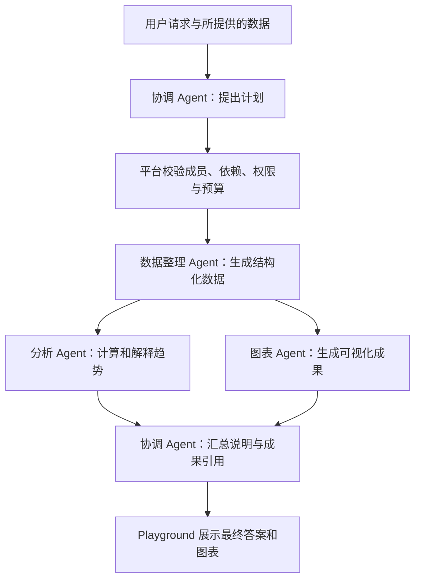
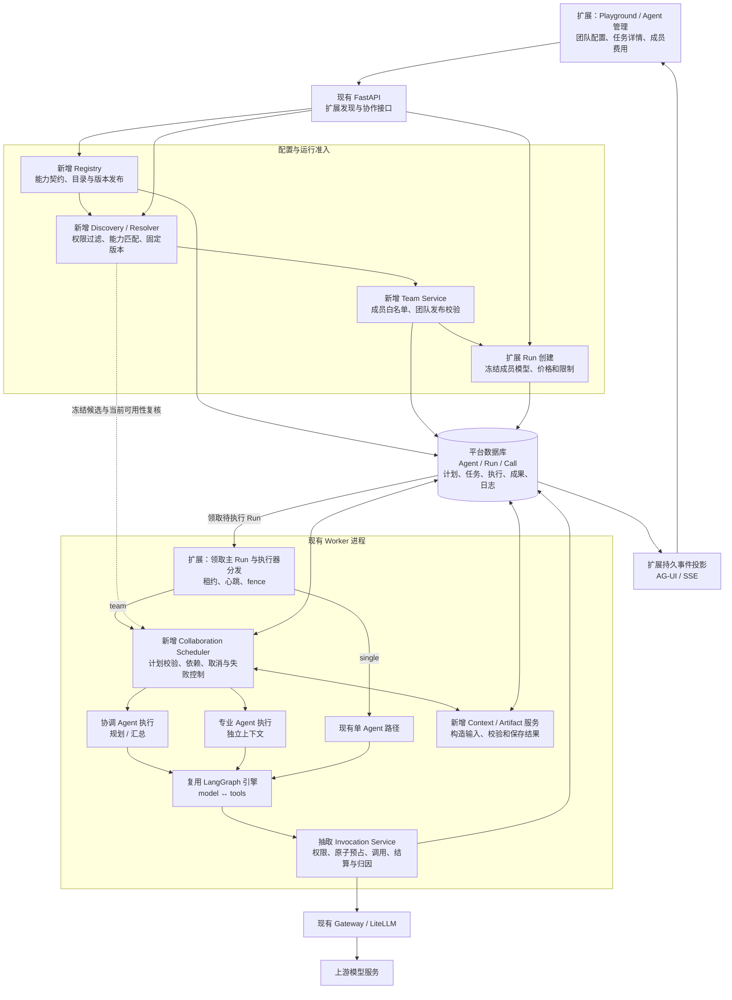
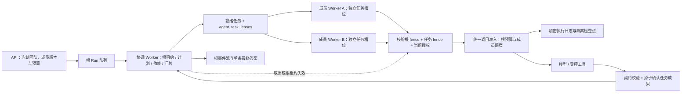

多 Agent 协作设计方案
====================

创建日期：2026-10-29；更新日期：2026-10-30。状态：阶段 A、B 已实现并验证；阶段 C 的 C1–C4 已实现，C5 待真实模型评估；阶段 D 的 D1 已实现并验证，D2 基础模块实现中。本文以当前工作区实现为基础，包括尚未提交的修改，不代表已部署版本。实施状态以第 11 节为准；阶段 C 的上线放行与阶段 D 仍按目标设计管理，不能将代码提交视为全部验收完成。

建议采用“平台内 Agent 注册目录 + 受限发现 + 协作调度器 + 现有单 Agent 引擎”：协调 Agent 理解请求、提出分工并汇总结果；专业 Agent 完成限定任务；平台负责注册发布、候选发现、计划校验、调度、权限、预算、取消与恢复。一次用户提问仍对应一次主 Run，各专业 Agent 的执行记录归属于该 Run。第一版模块运行在现有 API / Worker 内，复用数据库和 LiteLLM，不新增独立注册中心或调度微服务。

首版假设：同一组织内协作，使用现有模型目录、LiteLLM 和已发布 Agent；输入沿用当前文本会话；专业 Agent 可以使用已有工具。接数据库、上传文件、联网检索、外部 Agent、跨组织协作均需要各自的能力建设，不能由协作能力自动获得。

**1. 设计起点与新增能力**

| 领域 | 设计起点已有实现 | 本方案新增（实施状态见第 11 节） |
| --- | --- | --- |
| 执行引擎 | `modules/runtime/engine.py` 的 LangGraph 模型—工具循环 | 编排服务、任务依赖、任务输入输出契约 |
| Agent 与会话 | 发布版本；Session 固定关联 Agent；Run 保存执行快照 | 协作型 Agent；冻结协调者和全部成员版本 |
| 注册发现 | `save_agent()` 登记配置、`publish()` 保存版本、租户内列表查询、内置模板安装 | 版本化能力描述与契约、候选过滤、团队白名单内发现、当前可用性控制 |
| Worker | Run 租约、心跳、fence、防止旧 Worker 写入 | 协作任务状态、检查点、按任务恢复策略 |
| 持久化 | Run、事件、模型调用和账务凭据 | 任务、执行尝试、结构化结果、成果引用、执行日志 |
| 恢复 | SSE 重放；失联 Run 保守失败，不自动重放请求 | 已确认结果复用；仅在安全边界继续未完成任务 |
| 协议 | AG-UI 1.0 + SSE；当前依赖已有子 Agent 事件类型 | 事件归属、协作状态投影、协作详情面板 |
| 计费 | 每次模型调用权限检查、预占与结算 | 主运行总预算、子任务预算、并行准入 |

阶段 C 已通过 `modules/runtime/journal.py` 接入加密持久执行证据，并通过 `modules/runtime/checkpoints.py` 为单次执行接入 LangGraph checkpointer。事件重放、账务补证和恢复执行是三个不同能力，需要分别实现和验收。

设计起点的 Worker 为一个 Run 调用一次 `execute_agent()`。阶段 B 已新增 `modules/collaboration/scheduler.py`，团队分支在一个根租约内按固定计划驱动多次隔离的成员执行并汇总；AG-UI 输出带执行归属的子 Agent 事件。阶段 C 已实现冻结候选中的动态规划、同 Worker 双任务并行和基于证据的受控恢复；相关开关默认关闭，C5 尚未全部验收。不能把普通 Worker 并发或 SSE 重连当作这些能力。

**2. Playground 与 Agent 配置**

Agent 编辑器增加“执行方式”：单 Agent、团队协作。协作型 Agent 继续作为现有 Agent 资源发布，所以 Playground 选择器可以同时展示普通助手与协作助手；会话仍绑定一个入口 Agent。

协作型 Agent 配置包括：协调者提示词与模型、成员 Agent 列表、成员职责、允许委派的任务类型、输入输出契约、执行策略、任务数量与并行上限、总预算。成员可以采用不同模型，角色差异来自提示词、工具与上下文，不要求每个角色使用不同模型。

首版采用已发布成员白名单。成员必须是单 Agent，禁止嵌套团队和递归委派。团队发布时解析并固定成员版本；成员发布新版后，团队维护者需显式更新团队版本。主 Run 创建时再冻结可执行的完整配置、模型路由策略、工具契约、价格关联与限额，不在运行途中重新读取“最新版”。权限撤回和模型停用仍实时生效。

用户发送消息后，主会话显示最终答案与成果；旁边可展开协作过程：

```text
数据分析团队                                      进行中
  协调助手       已完成分工
  数据整理助手   已完成       输出：标准化月份与数值
  分析助手       已完成       输出：趋势与异常说明
  图表助手       正在执行     输入：标准化数据
  协调助手       等待汇总

已确认费用 / 待确认费用 / 本次上限                  停止协作
```

每个任务可查看任务说明、输入摘要、来源、交付结果、耗时和授权范围内的用量。默认展示工作进度和结果摘要；无需展示各 Agent 的内部推理全文。主对话保存一条统一助手答案，子任务内容放在独立详情中。

普通会话保持原有模型选择语义。协作会话的选择器标为“协调模型”，成员模型在团队详情中展示；如果允许单次覆盖协调模型，应将覆盖项写入请求指纹和 Run 快照，不能隐式覆盖所有成员。

用户在下一轮说“把刚才的图改成柱状图”，协调者读取服务端主会话历史和被授权的成果引用，只委派相关修改任务。子 Agent 默认每次调用使用独立上下文，历史成果通过显式引用复用。

**2.1 注册目录与能力描述**

注册对象是平台可执行的 Agent 定义和发布版本。内部 Agent 由公共 Worker 执行，没有单独的服务进程，因此首版不为每个 Agent 登记 URL、实例心跳或服务地址。沿用现有创建、修改、发布 API，以及 `platform_agents` / `platform_agent_versions`，避免出现两份相互漂移的注册数据。

| 新增或扩展信息 | 约定 |
| --- | --- |
| `execution_mode` | `single` / `team`；旧数据默认 `single` |
| `capability_keys` | 明确能力标识，如 `data.normalize`、`data.analyze`、`ui.chart`；命名及数量受 schema 限制 |
| `task_types` | 允许承担的任务类型，作为发现和计划校验条件 |
| 输入输出契约 | 每种任务类型绑定带版本的契约和 schema 摘要；发布时保存 schema 与摘要，不能引用可变的“最新版” |
| `collaboration_spec` | 成员、角色、固定版本、任务模板、并发数、预算与失败策略；仅 `team` 使用 |
| 当前执行可用性 | 独立于版本快照的启停控制；用于撤回执行资格，不通过修改历史版本实现 |

能力、契约和角色说明随版本发布；Agent 草稿修改不会改变已发布团队。当前可用性、用户权限和模型停用状态则每次执行前复核。停用后旧团队也不能继续发起该成员的新调用。新增启停操作要求 `agents.manage` 并记录审计；已有数据迁移后默认可用，未发布 Agent 仍不能执行。

能力描述由有权限的维护者填写并在发布时校验；它表示声明的任务接口，不是模型质量保证。结构化契约不能仅依靠自由文本 `description`，质量通过阶段验收任务集验证。首版契约匹配要求明确的标识、版本与内容摘要一致，暂不推断任意 JSON Schema 之间的兼容性；转换数据应使用显式转换任务。

**2.2 发现、准入与版本解析**

| 时点 | 允许发现的范围 | 固定结果 |
| --- | --- | --- |
| 团队编辑与发布 | 当前租户内、当前操作者有权使用、可用的已发布单 Agent | 发布时重新校验，保存成员 `agent_id + version`、能力及契约摘要 |
| 主 Run 准入 | 已发布团队中的成员版本 | 按用户当前授权解析每个成员的有效模型、工具、价格和限额，形成完整团队快照 |
| 运行中选人 | 本次 Run 已冻结的成员集合 | 根据任务需求选择具体成员，实时复核可用性；不得扩展白名单或切到新版本 |


阶段 A/B 使用规则过滤、显式优先级和固定模板，无需向量检索。阶段 C 才将受限候选描述提供给协调者。可通过内部 `DiscoveryService.resolve()` 或协调者专用 `discover_agents` 适配暴露；工具中的主 Run、租户与白名单由服务端注入，模型不能覆盖。发现不授予执行权限，也不自动创建任务。

候选只返回 Agent ID、已固定版本、职责、能力和契约摘要，不返回系统提示、凭据或未授权资源。无候选时返回可处理错误，例如 `no_eligible_agent`、`contract_mismatch`；仅向有权查看的调用者解释具体拒绝原因，避免泄露其他租户或无权访问的 Agent。成员在发布与运行之间被停用时，返回明确失败，不静默替换成员。

外部 Agent 的远程端点、协议适配、健康检查、实例发现和跨组织授权留到阶段 D。数据库中的内部 Agent 目录与未来远程实例目录分别建模。

**3. 协作方式与具体示例**

建议先支持有边界的任务依赖图：独立任务可以并行，依赖上一步结果的任务顺序执行。协调者可以直接完成简单问题，也可以生成任务计划。分工、参数修复和最终汇总都消耗模型调用，计入主运行预算。

例如用户在消息中提供月度数据，并要求“分析趋势、给出说明并生成折线图”：



图表依赖标准化数据时可与分析并行；如果图表需要标注分析得出的异常点，则把分析加入图表依赖，按顺序执行。没有真实数据时先澄清，或仅在用户要求示例时明确使用示例数据。多 Agent 本身不提供业务数据源。

首版提供预定义协作模板，验证稳定后开放协调者生成受限计划。动态计划先通过结构化 schema 校验，再检查：成员属于发布白名单、任务数量有上限、依赖目标存在、没有循环、输出契约兼容、权限和预算允许。协调者不能提交任意 URL、密钥、Python 或新的系统提示替代成员配置。

**4. 执行架构与权威状态**



图中模块在现有进程内组合，不代表新增微服务。Registry 管理 Agent 的已发布能力；Discovery 解析可用候选；Scheduler 管理任务执行次序与状态。当前 Worker 仍从数据库轮询领取主 Run，事件通知中的 Redis 唤醒不能画成子任务消息队列。

运行链路分三层：

- 协调 Agent：输出计划或最终答案，承担模型决策；无法直接授予权限、扣款或创建任意执行进程。
- 编排服务：持久化计划与任务状态，选择就绪任务，执行额度准入与失败策略，是协作控制状态的唯一写入入口。
- 专业 Agent：复用现有 LangGraph 模型—工具循环；每个执行拥有独立消息上下文、调用编号和结果。

数据库的计划、任务、执行日志为权威状态。Redis 在事件链路只负责唤醒。阶段 C 接入的 LangGraph 检查点保存单个 Agent 的内部执行进度，不能独立授权重放模型调用或重新创建任务；恢复必须先通过平台执行日志、当前租约与费用证据校验。

第一阶段由持有主 Run 租约的一个 Worker 执行该团队。后续在同一 Worker 内增加受限异步并行，避免主任务占据 Worker 后又排队等待自己的子任务。分布到多个 Worker 的任务租约作为独立后续阶段，不能直接将子任务递归提交到当前普通会话 Run 队列。

主 Run 与现有会话串行规则保持一致。子执行不新增用户会话、不竞争会话写锁、不写多条普通助手消息。当前 `platform_messages` 有 `(run_id, role)` 唯一约束，这是采用独立任务/执行表的重要原因。

**4.1 新增模块与现有模块改造**

以下路径相对于 `agent_platform/`。新模块复用现有数据库、事务和服务组装方式，不直接跨模块修改对方的内部状态。

| 模块 | 新增 / 改造 | 职责与边界 |
| --- | --- | --- |
| `modules/agent_registry/` | 新增 | 版本化能力契约、目录查询、发布校验、候选发现与版本解析；复用现有 Agent 表 |
| `modules/collaboration/team.py` | 新增 | 团队定义、成员固定版本、白名单和快照构建 |
| `modules/collaboration/planner.py` | 新增 | 固定模板和动态计划共用 schema；依赖、成员、契约、规模校验 |
| `modules/collaboration/scheduler.py` | 新增 | 就绪任务、并发准入、状态迁移、失败传播与汇总触发 |
| `modules/collaboration/context.py` | 新增 | 任务信封、上下文裁剪、授权成果引用解析；隔离成员消息 |
| `modules/collaboration/artifacts.py` | 新增 | 结构化结果校验、不可变成果保存、来源与完整性检查 |
| `modules/runtime/invocation.py` | 抽取新增 | 从 Worker 提取模型调用、权限复核、路由、预占、流式输出和结算；两种执行器共用 |
| `modules/runtime/journal.py` | 新增 | 实现现有 ExecutionJournal 契约；记录意图、发送状态、确认与未知证据 |
| `infrastructure/collaboration_tables.py`、`migrations/` | 新增 | 计划、任务、执行、成果、日志及租户约束；迁移兼容旧数据 |
| `modules/runtime/engine.py`、`contracts.py` | 改造 | 类型化执行上下文、结构化输出与执行日志适配；保持单 Agent 兼容 |
| `apps/worker/main.py`、`modules/service_contexts.py` | 改造 | 执行器分发、服务组装、主租约和取消传播 |
| `modules/billing/`、`run_records.py` | 改造 | 主预算和成员归因、原子预占、事件命名空间 |
| `apps/api/`、`modules/ag_ui.py` | 改造 | 注册发现与协作读取接口、权限、快照和事件转换 |
| `apps/web/src/` | 改造 | 团队编辑、成员发现、任务详情、根事件流与独立成果状态 |

**4.2 执行上下文与统一调用入口**

当前 `Worker.invoke()`、`authorize_call()` 和 `register_call()` 直接读取 `run["spec"]` 中的模型和 Agent 信息。成员可能使用不同模型，因此必须分离主运行控制信息与成员配置，不能在多个协程之间修改共享 `run["spec"]`。

新增不可变的 `ExecutionContext`，包含 tenant/user/session/root_run、task/execution/attempt、agent_id/version、主租约和 fence、截止时间、有效成员配置、模型路由与成员限制。主预算、取消和执行权来自主 Run；提示词、工具、模型与任务输入来自成员快照。单 Agent 使用兼容适配生成同类上下文；旧 Run 不要求补造团队任务。

统一 Invocation Service 在每次调用时复核当前权限、租约和模型状态，以主 Run 预占并结算，再以 execution/task 归因。模型逻辑调用和实际发送尝试各有稳定 ID；费用记录和完整执行输出分别保存。协调、输出修复和汇总走同一入口。生成式 UI 成果 ID 同样加入 execution 命名空间，不能继续只用 `step:tool_call_id` 在团队内标识产物。

现有 ExecutionJournal 契约以工具执行为中心；阶段 C 实现时需要补齐模型调用意图及证据契约，明确模型调用和工具调用两种记录类型，并关联现有 call/attempt 标识，不能把工具执行日志直接当作完整模型恢复记录。

**5. Agent 之间传递什么数据**

每次委派使用服务端生成的任务信封。以下为示意契约，字段最终需生成 API 与类型定义：

```json
{
  "schema_version": 1,
  "root_run_id": "run_example",
  "task_id": "task_chart",
  "agent_id": "agent_visualization",
  "agent_version": 3,
  "objective": "根据已确认的月度数据生成折线图",
  "context": {
    "user_request": "分析趋势并生成折线图",
    "session_summary": "用户希望保留月份标签和原始单位",
    "input_refs": [
      {"artifact_id": "artifact_monthly_data", "version": 1}
    ]
  },
  "output_contract": "chart_result.v1",
  "limits": {
    "max_model_calls": 3,
    "max_output_tokens_per_call": 8192
  }
}
```

返回结果包括 `status`、`summary`、符合契约的 `structured_output`、`artifact_refs`、`source_refs` 和 `warnings`。执行 ID、费用、Token 数由平台填写；不能信任模型自行报告的计量。

上下文分成三类：

| 数据 | 可见范围 | 传递方式 |
| --- | --- | --- |
| 本轮目标、必要会话摘要、明确的数据输入 | 本次任务授权范围 | 服务端构建任务信封 |
| 子 Agent 的系统提示、私有工具过程、内部状态 | 该执行及授权运维 | 保存在执行状态中，按需返回经过筛选的结果 |
| 数据集、图表、报告等成果 | 有权限且有引用的后继任务 | 不可变成果 ID、版本、内容摘要和来源 |

共享表示“在本次运行内按授权共享”，不表示组织所有成员都能读取。兄弟 Agent 不直接改写彼此的上下文；并行结果按任务 ID 分开保存，汇总者显式选择版本并处理冲突。读取引用时再次检查组织、会话访问权、成果授权及内容哈希。

大文本和成果用引用传递，平台在构建模型请求时只展开必要片段，设置字节数和 Token 限额。某个模型调用需要原生 Responses 续接信息时，信息留在该 Agent 自己的运行上下文内，不复制给其他成员。

数据通路为“Agent A 输出 → 平台校验并保存 → 按依赖构建 Agent B 输入”。专业 Agent 调用外部模型时，分配给它的数据会通过 LiteLLM 发送到所配置的模型服务；多个 Agent 不等于所有计算都在本机进行。成员模型选择应遵守组织的数据使用与模型授权策略。

**6. 数据模型和兼容方式**

以下是建议的逻辑结构；独立表名和索引随迁移评审确定。

| 资源 | 主要字段 | 约束与职责 |
| --- | --- | --- |
| 现有 Agent / agent_version | `execution_mode`、能力、任务类型、输入输出契约、`collaboration_spec` | 默认 single；发布冻结能力及契约；team 固定成员版本 |
| 现有 Agent 当前控制字段 | 执行可用性、变更审计 | 可用性不从历史快照恢复；实时停用对旧团队同样生效 |
| 现有 Run.spec | 新快照版本、团队快照、有效限制、模型选择 | 旧快照继续由原执行器处理，未知版本拒绝 |
| collaboration_plans | tenant、root_run、revision、plan、hash | 计划不可变版本；运行只能使用已接受版本 |
| agent_tasks | tenant、root_run、plan_revision、logical_task_key、dependencies、status、required | 逻辑任务；重试仍属于同一个任务 |
| agent_executions | task、attempt、agent_version、input_digest、status、output、parent_execution_id | 一次实际调用实例；协调和汇总也计入 |
| execution_journal / checkpoints | tenant、root_run、execution、step、call_id、revision、fence、intent、evidence | 调用发送前记录意图；结果保存后才解锁下游 |
| collaboration_artifacts | producer_execution、version、type、content/reference、digest、validation_status | 不可变成果；区分生成、校验与浏览器渲染状态 |
| 现有模型调用与预占 | root_run 保留，新增 execution/task 关联 | 钱包扣费仍在现有账务链路；支持归因 |
| 现有运行事件 | root_run、sequence、execution/task 元数据 | 主流全局单调序号；事务持久化后通知 |

所有关联包含 `tenant_id`，适用的生产 RLS、删除/保留策略与访问审计一并扩展。任务唯一键采用 `(tenant_id, root_run_id, plan_revision, logical_task_key)`；执行尝试采用 `(tenant_id, task_id, attempt)`。同一任务的重试生成新的 execution ID，AG-UI 的 `subagentRunId` 对应一次 execution，不能使用可复用的 Agent ID。

LangGraph 检查点命名空间包含 tenant、root_run、task、attempt，存储访问必须校验身份，不能只靠命名空间防止越权。过期 Worker 写任务、检查点、事件和结算凭据都必须经过当前 fence 校验。数据库任务更新与事件记录在同一事务提交；检查点引用在执行记录确认后才允许推进任务状态。

**7. 状态、失败与恢复**

本节恢复流程是阶段 C 的目标能力。阶段 B 仅保存任务结果并提供事件重放，Worker 失联沿用现有保守失败策略，不自动接管续跑；已确认成果与用量仍保留。阶段 C 完成执行日志、检查点和故障注入验收后，才允许新租约持有者按以下规则继续。

逻辑任务建议状态为：`pending → ready → running → succeeded / failed / cancelled / blocked`。临时限流进入 `waiting_capacity`；未知外部调用结果进入 `waiting_evidence`。这两个等待状态不应伪装成重新执行。

主 Run 继续使用现有生命周期；增加独立结果字段 `outcome=complete|partial`。只有发布策略允许且核心交付满足时，缺少可选分支才可以 `succeeded + partial`。必须完成的任务失败则主 Run 失败，页面明确说明缺失内容，同时保留已验证成果。

执行顺序是：验证主租约 → 持久化调用意图与预占 → 标记待发送调用 → 调用模型 → 保存原始证据与结果 → 原子确认执行及成果 → 将后继任务置为 ready。结构化输出校验失败可有限修复，修复次数与费用计入原任务和主运行。

| 场景 | 处理原则 |
| --- | --- |
| 浏览器断流、刷新 | 重放同一主 Run 的事件和快照，不新建任务、不再调用模型 |
| 子任务完成后 Worker 退出 | 复用已确认输出，从未完成依赖继续 |
| 请求尚未发出且意图已保存 | 新租约持有者校验日志和预算后可继续发送 |
| 已调用模型但结果未知 | 补查网关/用量证据；无法证明可重放时停止该任务，不盲目重试 |
| 纯本地计算 | 可以按契约重新计算；时间查询等观察值需复用已记录结果 |
| 临时 RPM/TPM 满 | 有界排队并展示等待原因；超过期限明确失败 |
| 单次请求自身大于额度 | 直接说明输入/输出预留超过限制；排队不能解决 |
| 用户点击停止 | 主 Run 先持久化取消，阻止新任务和新调用，传播取消到全部执行 |
| 停止时已有上游请求 | 尽力中断，保留费用待确认状态；不承诺撤回供应商已经执行的请求 |
| Agent/模型权限被撤销 | 下一个调用或数据读取前拒绝，不能靠旧快照继续使用 |

不承诺任意断电时点的外部调用“恰好执行一次”。数据库任务创建和结果确认可以幂等；外部调用的不确定区间必须通过稳定调用标识、发送日志与补证处理。确认了费用不代表已经拿到了足够恢复执行的完整输出，两类证据分别判断。

单任务重试首版只对已明确失败且允许重试的执行开放；不能将成功任务静默重做。后续若允许修改成功任务输入，需要创建派生 Run 或新的计划修订，使依赖该结果的后继任务失效并明确重新计费。终态主 Run 不原地改写历史。

成果状态独立于整个 Run。某个 Agent 已生成并校验完整图表，后续汇总失败时仍可展示该成果并标注“协作未全部完成”；图表是否可运行由自身完整性、隔离校验与浏览器状态决定，避免当前仅依据整个 Run 失败就停止完整图表的行为。

**8. 权限、预算和容量**

实际委派权限取“当前用户权限 ∩ 团队对该成员的委派范围 ∩ 成员已发布工具/模型范围 ∩ 当前组织与平台策略”。团队维护者发布某成员不等于所有调用者获得该成员权限。每次成员选择、成果读取和外部调用均检查当前身份；模型输出中声称已获批准不能当成授权。

所有 Agent 的模型请求复用现有平台受控入口和 LiteLLM。工具及模型返回内容作为任务数据处理，不提升为系统指令；客户端不能通过传入任务 ID、成员模型、工具、提示词或 `parentRunId` 来构造越权子执行。首版只启用已有受控工具，后续外部写操作需要单独的工具契约、授权与持久日志接入。

预算按主 Run 统一控制：

```text
本次协作费用 = 协调规划 + 所有子 Agent 的调用 + 结果修复 + 最终汇总
已确认消费 + 未结算预占 + 新调用的最坏情况预占 <= 有效主运行预算
```

子任务额度是同一主预算内的分配约束，不再向钱包收取第二笔“团队费用”。失败、重试、被取消但已被上游执行的调用都保留实际费用归属。汇总阶段保留一定预算，防止专业任务耗尽额度后无法给用户交付说明。

并发调用的额度检查与预占必须在数据库中原子完成，不能让两个 Agent 分别读取相同余额后各自认为额度充足。RPM/TPM 按真实模型调用累计，根 Run 占一个组织运行名额，同时增加组织级“活跃 Agent 执行数”上限，防止一个团队绕过现有并发限制。等待容量的任务不占活跃调用名额。

先沿用已验证的保守 Token 估算方式，配合按角色设置较小输出上限；不能把估算器替换为未经验证的近似值。后续可增加经过模型路由兼容验证的 Token 估算器。网关与供应商限制仍需独立遵守；平台暂时无法精确读取下游余量时，不能承诺完全不会出现下游 429。

此前出现的 `entitlement tpm limit exceeded` 提示，说明协作前必须把有效限额来源展示清楚。组织设置“不额外限制”仍受平台套餐、网关和供应商约束。错误返回建议带 `limit_source`、`requested_reservation`、`effective_limit` 与可用时的 `retry_after`，只展示调用者有权查看的范围。

建议的首个试用模板值如下，均可配置，不改变现有单 Agent 的默认行为：

| 项目 | 建议值 |
| --- | --- |
| 专业 Agent 数 | 2–4 个 |
| 委派深度 | 1 层 |
| 业务任务数 | 最多 8 个，包括返工任务 |
| 并行执行 | 先串行验证，随后默认最多 2 个 |
| 每个任务模型调用 | 最多 3 次 |
| 主运行模型调用 | 最多 20 次，包含协调、修复和汇总 |
| 每次最大输出 | 按角色配置 4096–8192 Token，受所选模型能力限制 |
| 总费用 | 沿用有效主 Run 上限，并可进一步收紧 |
| 总超时与排队期限 | 沿用已冻结的运行策略；未配置总超时也必须受调用数和费用约束 |

这些值是试用起点，需要通过任务集测量完成率、成本和耗时后再调节。

**9. 接口和事件**

继续使用已有 Session 创建与 AG-UI 提交接口，服务端根据会话绑定 Agent 的执行方式选择执行器。浏览器不负责展开任务图，也不直接调用子 Agent。

建议新增读取接口：

- `GET /api/v2/tenants/{tenant_id}/runs/{run_id}/collaboration`：计划、任务状态、执行归因、费用摘要和成果引用。
- `GET /api/v2/tenants/{tenant_id}/runs/{run_id}/tasks/{task_id}`：当前用户获授权的任务输入摘要和结果。
- 原 `POST .../runs/{run_id}/cancel` 扩展为取消整个团队。
- 阶段二如开放失败任务重试，增加 `POST .../runs/{run_id}/tasks/{task_id}/retry`，带幂等键、期望任务修订；终态后重试产生派生运行。

Agent 草稿及发布沿用现有 API，扩展 schema；新增字段加入发布校验、OpenAPI 和前端生成类型。运行输入幂等指纹包含所有会改变执行的显式参数；同一次请求重放必须返回原 Run 和任务，不重新展开计划。

注册发现接口补充如下，均要求显式租户身份：

| 接口 / 内部入口 | 用途与约束 |
| --- | --- |
| 现有 `POST .../agents`、`PATCH .../agents/{agent_id}`、`POST .../agents/{agent_id}/publish` | 扩展能力、契约、执行方式及团队配置；发布时重新校验成员 |
| `GET /api/v2/tenants/{tenant_id}/agents/discovery` | 按能力、任务类型及契约筛选已发布候选；限制页大小并使用游标；响应经过权限筛选 |
| `PATCH /api/v2/tenants/{tenant_id}/agents/{agent_id}/availability` | 修改当前执行可用性；要求 `agents.manage`、记录审计；不改写发布版本 |
| 内部 `DiscoveryService.resolve()` | 接受服务端构造的租户、用户、冻结候选范围与契约；返回确定版本或受控失败 |

`/agents/discovery` 作为静态路径注册，新增通用 `/{agent_id}` 读取路由时避免路径冲突。运行中调用发现必须绑定主 Run，不能仅凭客户端提交 `agent_id` 或 `team_id` 扩大候选范围。发现结果无执行凭证效力，实际调用仍经过统一准入。

当前安装的 Python `ag-ui-protocol==1.0.0` 与前端 `@ag-ui/core@1.0.2` 已包含以下事件。本次已检查本地类型定义，不需要为基本子 Agent 生命周期自创协议：

| 事件 | 用途 |
| --- | --- |
| `SUBAGENT_STARTED` | 一次执行开始，包含独立的 `subagentRunId`、名称与任务描述 |
| `SUBAGENT_FINISHED` | 执行完成，携带经过权限筛选的结果摘要 |
| `SUBAGENT_ERROR` | 子执行失败；不立即结束整个团队事件流 |
| 带 `subagentRunId` 的文本、工具事件 | 将过程输出归入正确任务 |
| `STATE_SNAPSHOT` / `STATE_DELTA` | 一个主 Run 状态文档中的 collaboration 投影 |
| `ACTIVITY_SNAPSHOT` / `ACTIVITY_DELTA` | 图表等成果内容及状态 |
| 根 `RUN_FINISHED` / `RUN_ERROR` | 整个协作任务终结 |

协议职责仍为前端与运行时交互，内部任务调度采用平台契约。根流统一分配持久事件 sequence；每个 execution 的消息、工具与成果 ID 都加入命名空间。状态 Delta 作用于同一主状态文档的不同 task 路径，不能让成员分别覆盖整个共享状态。

继续支持现有 `sequence.part` 重连游标。重连快照必须还原任务树、活跃执行、已确认结果和成果，再重放游标之后的事件。相同快照和事件组合的前端状态应一致，不能因为并行到达顺序导致文本串台。

**10. 实施阶段与验收**

| 阶段 | 交付内容 | 放行条件 |
| --- | --- | --- |
| A：注册发现与执行基础 | 能力契约、目录发现、团队快照、ExecutionContext、统一调用入口、任务/成果表 | 租户及版本隔离正确，旧快照兼容，单 Agent 回归通过 |
| B：首个协作闭环 | 协作 Agent 编辑发布；固定模板顺序执行；统一答案；任务面板；取消；费用归因 | 能完成“数据整理→分析/图表→汇总”；刷新不重复调用；失败保留成果 |
| C：受限动态与并行恢复 | 白名单计划、最多 2 个并行任务、原子预算、持久执行日志和检查点、按任务恢复 | 并行不超预算、不串数据、不重复任务，未知调用不重放，撤权及时生效 |
| D：后续能力 | 多 Worker 子任务租约、任务返工、人工节点、长期记忆、外部协作协议、工作流画布 | 每项单独定义权限、恢复和产品契约后开放 |

阶段 B 是最小可交付版本，采用固定模板、单 Worker 顺序执行和失联保守失败；阶段 C 后才开放动态规划、成员并行及受控续跑。A/B 不声明自动断点续跑，不能仅在现有 `execute_agent()` 外包一个并发调用就上线。

建议改动位置：

| 位置 | 责任 |
| --- | --- |
| 新增 `modules/agent_registry/` | 版本化能力、契约、当前可用性、候选查询与解析 |
| 新增 `modules/collaboration/` | 团队定义、计划契约、上下文构建、调度和结果汇总策略 |
| `modules/runtime/engine.py`、`contracts.py` | 单 Agent 执行上下文、结构化结果、执行日志与恢复适配 |
| `apps/worker/main.py` | 根据模式选择执行器；传递主运行与子执行归属；取消与租约 |
| `modules/billing/`、`run_records.py` | 主预算原子预占、费用归因、记录投影 |
| `infrastructure/`、`migrations/` | 任务、执行、成果、日志表及租户约束 |
| `apps/api/`、`modules/ag_ui.py` | 配置与查询 API；子 Agent 事件映射；重连快照 |
| `apps/web/src/Playground.tsx`、`useAgentRun.ts`、`ag-ui.ts` | 团队入口、单根流、按任务归属的状态处理 |
| `apps/web/src/Artifact.tsx` 及新增协作面板组件 | 独立成果状态、任务树、过程详情和费用展示 |

验收覆盖真实的故障边界：

1. 用户只发一条消息，至少两个已发布 Agent 接力；后继输入能够追溯到前驱已确认输出。
2. 一次协作只形成一条主对话答案，能查看每个子 Agent 的任务、结果、模型和费用；没有数据时不会虚构业务结果。
3. 并行任务只读取各自被分配的上下文；错误 Agent ID、跨组织成果、已撤销权限全部拒绝。
4. 在计划保存、任务创建、模型发送、响应返回、结果确认等边界注入进程退出；已确认成果不重复执行，未知请求不自动重发。
5. 两个并发执行争用最后一份预算时只允许合法预占；组织运行限额、Agent 活跃数、TPM 与下游 429 分别验证。
6. 取消和任务完成竞争时，取消后不派发新请求；已确认用量照常结算，未知用量保留待确认状态。
7. SSE 在任意事件边界中断后重连，任务树和图表恢复一致、调用次数不增加；成员错误不提前终止根流。
8. 必选分支失败如实失败，可选分支失败按发布策略部分交付；已完整校验的图表不被汇总失败一并禁用。
9. 单 Agent、旧版本 Run、现有登录/组织隔离与计费报表通过回归；SQLite 本地开发与 PostgreSQL 多 Worker 约束分别验证。
10. 使用固定任务集与单 Agent 基线比较成功率、总 Token/费用、首个可用结果时间和总耗时，只有有收益的场景默认推荐团队模式。

上述验收按阶段启用：阶段 B 验证固定模板、隔离、取消、事件重放与保守失败；并行预算竞争和执行接管恢复属于阶段 C。不能用 SSE 重连成功替代恢复执行验收。

开发先使用确定性模拟模型与网关验证协议、并发和故障恢复，再用真实模型做小规模质量评估。阶段上线使用组织级功能开关；关闭开关阻止创建新团队运行，已有运行继续使用对应版本执行器完成或明确取消。

**11. 可执行开发任务**

以下任务中 A、B 已完成，C1–C4 已实现且 C5 待真实模型评估，D1 已实现并验证，D2 实现中（本次实施目标包含 D）；未创建外部工单。每项可以作为一个独立 PR 的范围起点；迁移与调用入口抽取优先小步合并。依赖指必须先具备的契约或实现，所有阶段在组织级功能开关后开放。

**11.1 阶段 A：注册发现与执行基础**

| ID / 状态 | 任务与改动范围 | 依赖 | 完成标准 |
| --- | --- | --- | --- |
| A1 / 已完成 | 在 `runtime/contracts.py`、API schema 中定义 Agent 能力、任务契约、团队配置、ExecutionContext 与新 Run 快照版本；明确旧版本分发 | 无 | 明确每个字段来源；未知快照版本拒绝；旧快照和单 Agent 输入兼容；团队成员禁止嵌套 team |
| A2 / 已完成 | 新增 `collaboration_tables.py` 和迁移；扩展 Agent、Call 归因；建立计划、任务、执行、成果表及唯一约束 | A1 | SQLite / PostgreSQL 迁移通过；旧 Agent 默认 single 且可用；跨租户关联被拒绝；升级不丢失历史 Run；生产 RLS、删除和保留策略同步覆盖 |
| A3 / 已完成 | 实现 Registry、Discovery 和可用性控制；扩展创建/发布 API，新增发现及可用性 API；内置模板走统一契约校验 | A1、A2 | 草稿和无权限候选不可见；契约按版本及摘要匹配；排序和游标稳定；停用即时生效；更改有审计；没有候选返回受控原因 |
| A4 / 已完成 | 从 `Worker` 抽取 `runtime/invocation.py`，更新 `service_contexts.py`；单 Agent 通过 ExecutionContext 适配；补充 execution/task 归因 | A1、A2 | 原有单 Agent 调用、取消、输出截断、预占结算和未知用量处理通过回归；模型配置不再依赖可变共享 Run；不双重扣费 |
| A5 / 已完成 | 实现 `collaboration/team.py`；团队发布校验、成员版本固定、Run 准入完整快照与模式分发；团队执行入口先受开关保护 | A3、A4 | 团队包含成员契约和固定版本；成员发布新版不改变已发布团队；准入按用户权限解析成员模型；成员停用或模型撤权时拒绝；运行中不读最新版 |

阶段 A 检查点（2026-10-30 已通过）：Registry 和发现接口可独立验收，单 Agent 行为保持兼容；团队尚不能开放执行。实现位于 `codex/multi-agent-collaboration` 分支阶段 A 提交。当前已有 `0012_agent_registry` 迁移、能力契约及发现/可用性 API、团队发布和准入快照、统一 Invocation Service、独立 ExecutionContext、协作数据表与清理策略。

验证记录：97 项单 Agent/Worker/生命周期/迁移/权限/接口契约回归通过；11 项注册发现专项测试通过（含执行归因、内容清理）；真实 PostgreSQL 17 的迁移与角色引导 1 项、RLS/跨租户外键/最小权限/并发预占 6 项通过。隔离 PostgreSQL 容器由测试创建并清理，未访问部署数据库。Ruff 与差异格式检查通过。

阶段 A 运维入口：平台开关 `PLATFORM_COLLABORATION_ENABLED` 默认 false；组织开关通过 `GET/PATCH .../agents/collaboration-settings` 读取和修改，PATCH 需要 `enabled` 与 `expected_version`。两个开关均打开才允许团队准入。阶段 A 的 Worker 对团队 Run 明确返回 `team_executor_unavailable`；阶段 B 接入固定模板执行后移除此占位拒绝，仍不开放动态规划与并行。

**11.2 阶段 B：最小可交付协作闭环**

| ID / 状态 | 任务与改动范围 | 依赖 | 完成标准 |
| --- | --- | --- | --- |
| B1 / 已完成 | 实现 `planner.py` 的固定模板展开与统一计划校验，持久化计划修订和逻辑任务 | A5 | 拒绝循环依赖、缺失依赖、重复逻辑任务键、未授权成员及契约不匹配；同一入队请求只创建一组任务 |
| B2 / 已完成 | 实现 `context.py`、`artifacts.py` 和引擎结构化结果适配；定义数据整理/分析/图表输出契约 | A2、A4、A5 | 每个执行拥有独立消息列表；下游只读取已确认且获授权的成果；输出按 schema 校验；引用有版本和哈希；原生模型续接信息不跨成员复制 |
| B3 / 已完成 | 实现顺序 Scheduler 和 Worker 的 team 分支；协调/成员/汇总均产生执行记录；根 Run 统一结束 | B1、B2 | 一次请求至少两个 Agent 接力；不新建子 Session Run；只有汇总写普通助手答案；成功结果和状态原子确认；旧 fence 写入被拒绝 |
| B4 / 已完成 | 增加根/任务预算、汇总预留、模型调用数限制与取消传播；实现必选失败、可选部分完成、失联保守失败 | B3 | 规划和汇总均计费；成员累计不超过主限制；取消阻止新任务和新调用；必选失败阻断依赖；完整成果保留；失联不重放请求 |
| B5 / 已完成 | 新增协作详情/任务查询接口；扩展 `run_records.py`、`ag_ui.py` 子执行事件、命名空间与重连快照 | B3、B4 | `subagentRunId` 对应执行尝试；根 sequence 单调；成员报错不提前终止根流；重连不增加调用次数；任务详情校验会话访问权 |
| B6 / 已完成 | 更新 Agent 编辑页和 Playground；添加成员发现选择、团队详情、任务树、执行结果及费用；调整 Artifact 独立状态 | A3、A5、B5 | 团队可编辑发布并作为一个入口选择；单根事件流不会串台；已校验图表在汇总失败后仍可展示；普通会话交互回归通过 |
| B7 / 已完成 | 添加确定性协作夹具、端到端验收与上线开关；提供“整理→分析/图表→汇总”顺序模板和操作说明 | B1–B6 | 主答案、结果来源、成本与任务状态可核对；权限、取消、重复提交、断流、Worker 退出全部有确定预期；关闭开关阻止新团队运行；单 Agent 回归通过 |

阶段 B 检查点：可发布和使用同租户固定团队；一次请求展示统一答案、成员过程及完整费用归因。Worker 失联时明确失败并保留结果，界面不能显示“自动续跑”。操作与验收命令见 [固定团队协作操作手册](collaboration-operations.md)。固定模板规划不调用模型，持久化计划本身为分工依据；成员和模型汇总分别创建 Execution。

阶段 B 验证记录（2026-10-30）：完整后端测试执行 427 项，结果通过，20 项需独立环境的检查跳过；另使用一次性 PostgreSQL 17 容器验证 7 项（含真实服务角色的完整团队执行、RLS、权限、跨租户关联与并发预占），全部通过。前端构建、25 项浏览器及协议测试通过；真实临时 API/Worker 的浏览器协作验收另 1 项通过，覆盖执行中刷新、单一主答案、三成员加汇总、5 次调用不重放及图表交互。Ruff、生成 API 契约和 Git 差异检查通过。

实现交付包括 `0013_collaboration_outcome`、顺序调度与结果确认、任务级费用归因和详情接口、AG-UI 子执行映射、团队编辑与协作面板、原子且幂等的顺序模板安装、部署配置开关和操作手册。专项测试包含每个 SSE 游标的重放、取消、必选失败/可选部分交付、旧 fence 拒绝、Worker 失联保留成果、汇总失败后图表独立可用。这里的“已完成”不表示已经部署，也不表示模型回答质量优于单 Agent。

**11.3 阶段 C：动态发现、并行与受控恢复**

| ID / 状态 | 任务与改动范围 | 依赖 | 完成标准 |
| --- | --- | --- | --- |
| C1 / 已实现 | 给协调者开放冻结白名单的候选描述和受限计划输出；复用 B1 校验器；设置规划/修复次数上限 | B7 | 无法从提示词扩大候选或传入任意执行配置；没有候选可明确结束；循环、过量任务和无效契约不执行；规划费用归根 Run |
| C2 / 已实现 | 原子并发预算和容量准入；Scheduler 支持同 Worker 最多 2 个并行任务、等待容量与依赖解锁 | B7 | 两个执行争用最后预算时仅合法预占成功；汇总额度仍保留；活跃成员数单独限额；等待不占活跃调用名额；429 不形成无限重试 |
| C3 / 已实现 | 实现 `runtime/journal.py` 及日志迁移；接入模型/工具意图、发送标记、结果证据、当前 fence 和幂等键 | B7 | 发送前有持久记录；确认结果前不解锁下游；重复回调不重复确认；过期执行者不能写入；费用确认与完整输出证据分开判断 |
| C4 / 已实现 | 接入执行隔离的 LangGraph 检查点和任务恢复；扩展 Worker 接管、未知请求补证、观察值复用 | C3 | 在发送前后、响应后和确认后注入退出；成功任务不重做；未知调用不重发；结果证据不足停止或等待；检查点访问按租户和执行授权 |
| C5 / 部分完成，待真实模型评估 | 联合测试动态计划、并发、恢复、撤权和 SSE；执行与单 Agent 的质量/成本/延迟对比，更新运行手册 | C1、C2、C4 | 并行恢复组合不重复任务、不串上下文、不超预算；快照重放一致；明确启用条件及关闭流程；基于任务集决定默认团队场景 |

阶段 C 当前提交范围（2026-10-30）：C1–C4 的实现、迁移 `0014_execution_journal` / `0015_execution_checkpoints`、前端配置入口、故障注入及组合测试已纳入代码。C5 已具备确定性联合测试和真实模型对比脚本，真实模型评估尚未执行；缺少测试网关、模型、报价及总费用上限，因此暂不选定默认团队场景，也不宣称质量提升。运行开关、恢复边界与评估命令见 [协作操作手册](collaboration-operations.md)。

阶段 C 提交前验证（2026-10-30）：后端完整回归执行 468 项，通过，21 项因独立环境条件跳过；另在一次性 PostgreSQL 容器中验证 8 项，全部通过。前端构建、Ruff、生成 API 契约及 Git 差异检查通过。浏览器与协议检查 29 项通过；额外 4 项 `gateway.spec.ts` 失败，在上一提交 `8828b08` 的独立副本中全部复现，未作为本次新增回归。依赖部署账号的 `platform.spec.ts` 未纳入此次本地浏览器验证。真实模型评估仍待执行。

阶段 C 检查点：只有 C5 通过后才开放动态并行和自动受控续跑。C1/C2 即使提前合并也保持独立开关，不能隐含启用尚未验证的恢复路径。

**11.4 阶段 D：后续扩展任务，不纳入首版交付**

| ID / 状态 | 任务与边界 | 依赖 | 开放前验收 |
| --- | --- | --- | --- |
| D1 / 已实现并验证 | 多 Worker 子任务租约：独立任务领取、fence、容量和根取消协调；不复用普通 Session 入队 | C5 | 主任务不占满资源后等待自身子任务；重复领取、失联接管、取消竞争和预算争用均验证 |
| D2 / 实现中 | 外部 Agent 注册发现：独立远程描述、端点和凭据引用、协议适配、健康状态、结果与费用证据 | C5；若需跨 Worker 则另依赖 D1 | 明确调用边界、远程授权和幂等能力；地址与凭据受控；跨组织另行授权；远端取消和不确定结果处理有验收 |

任务返工、人工节点、长期记忆和画布在需求明确后另行拆任务，不能借本次任务默认引入。

D1 当前实现（阶段 D 仍未全部完成）：新增 `infrastructure/task_lease_tables.py`、迁移 `0016_member_task_leases` 与 `modules/collaboration/task_leases.py`。根 Run 仍是对话、预算和取消的共同边界；成员通过独立租约领取。D1 实现时完整后端回归执行 486 项，通过，22 项按独立环境条件跳过；一次性 PostgreSQL 验证 9 项通过。专项覆盖独立成员进程退出、跨 Worker 并行、根/任务接管、预算竞争、取消及停止时排空。运行参数和退场规则见 [协作操作手册](collaboration-operations.md)。



图中 D1 分布式分支通过独立开关控制；阶段 B/C 的单 Worker 路径仍保留。D2 已接入远程注册目录、加密凭据、管理 API、健康探测、发现和入队版本冻结，并新增严格协议契约与受控 HTTPS 传输基础。10 项契约及传输测试、6 项注册发现测试通过。远程成员执行、费用结算、未知结果恢复、取消及联合验收尚未完成，不能将不同 Worker 执行内部 Agent 描述为外部 Agent 协作。后续任务见 [远程 Agent 接入契约](remote-agent-protocol.md)。


**11.5 合并与验证约定**

- 每项任务交付实现、必要迁移、相关契约测试和文档状态更新；完成后在本表登记实际 PR/提交与验证结果，不提前勾选完成。
- A1–A5 先建立契约和基础；B1/B2 可在契约稳定后分别开发，B3 汇合；B7 是首个发布关口。C1/C2/C3 可在 B7 后分别推进，C4 依赖 C3，C5 统一放行。
- 新增测试文件建议为 `tests/test_agent_registry.py`、`test_collaboration_plan.py`、`test_collaboration_runtime.py`、`test_collaboration_recovery.py` 和前端 `tests/collaboration.spec.ts`；同时复用现有执行生命周期、计费与 PostgreSQL 隔离测试。文件名可按最终职责调整。
- API schema 变更后使用现有 `scripts/api_contract.py` 生成前端契约，避免手工维护两份类型；发布前检查单 Agent 和旧 Run 的兼容路径。
- 数据迁移先于开放团队功能；关闭功能开关只停止新准入。运行包含新快照时不能回退到不认识该版本的 Worker；先排空/明确取消相关运行或保留兼容执行器。迁移回滚不得删除已经产生的任务与计费证据。
- 确定性模拟网关用于权限、状态、预算与故障验证；真实模型仅用于后续小规模效果评估，不用随机模型回答替代协议与恢复测试。

**12. 选型依据**

LangGraph 官方将子图作为多 Agent 组合机制，并支持通过输入输出映射隔离不同 Agent 的私有状态。本方案复用现有单 Agent LangGraph 循环，在平台层维护可审计的任务依赖与执行权；将来是否把固定模板表达成外层子图，可作为适配细节，不改变业务契约。[LangGraph Subgraphs](https://docs.langchain.com/oss/python/langgraph/use-subgraphs)

LangGraph 区分线程范围的检查点与跨线程长期存储。首版只需要本次执行进度和显式会话摘要，长期共享记忆放在后续设计。[LangGraph Persistence](https://docs.langchain.com/oss/python/langgraph/persistence)

AG-UI 官方事件包含子 Agent 生命周期与输出归属，本地依赖也已具备对应类型；实施时仍需 Python 事件生成、TypeScript schema 消费和浏览器状态恢复的端到端契约测试。[AG-UI Events](https://docs.ag-ui.com/concepts/events)

任务是否值得多 Agent 化，取决于上下文隔离、专业分工和并行收益；协调与汇总也会增加调用和延迟。本方案允许简单任务直接回答，并要求用任务集评估收益。[LangChain Multi-agent](https://docs.langchain.com/oss/python/langchain/multi-agent)
