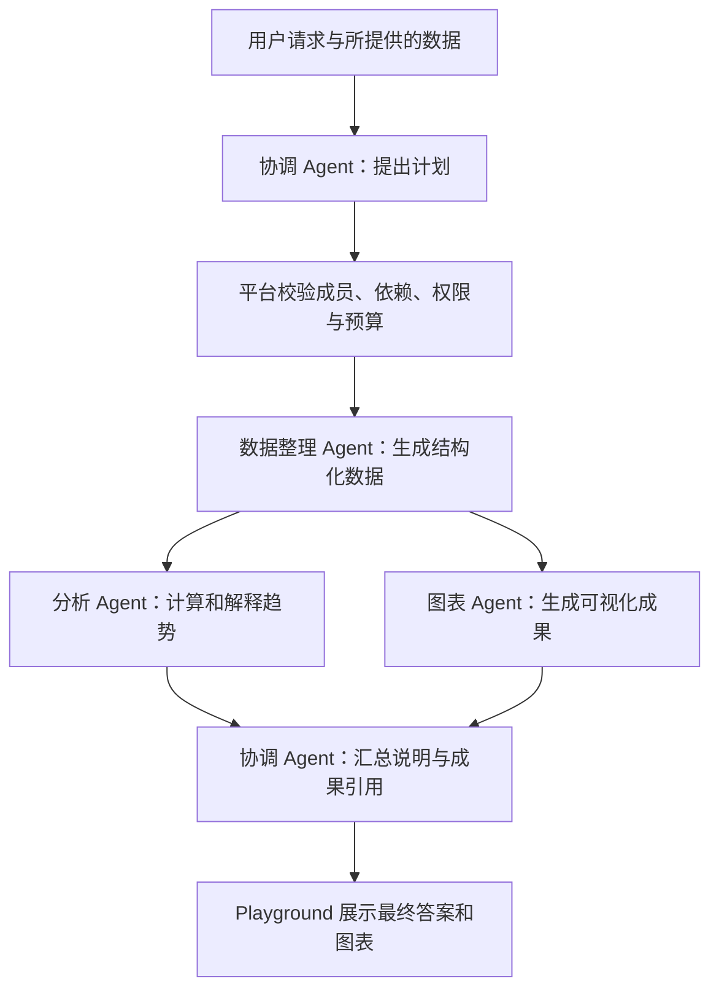
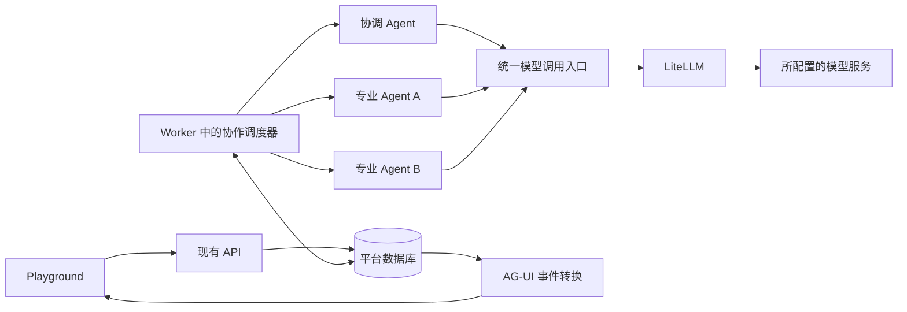

多 Agent 协作设计方案
====================

日期：2026-10-29。状态：设计提案，尚未实施。本文以当前仓库实现为基础；表中新增字段、接口、默认值与阶段划分均为建议。

建议采用“协调 Agent + 专业 Agent + 平台调度器”：协调 Agent 理解请求、提出分工并汇总结果；专业 Agent 完成限定任务；平台负责校验计划、调度、权限、预算、取消与恢复。一次用户提问仍对应一次主 Run，各专业 Agent 的执行记录归属于该 Run。

首版假设：同一组织内协作，使用现有模型目录、LiteLLM 和已发布 Agent；输入沿用当前文本会话；专业 Agent 可以使用已有工具。接数据库、上传文件、联网检索、外部 Agent、跨组织协作均需要各自的能力建设，不能由协作能力自动获得。

**1. 当前基础与必须补齐的部分**

| 领域 | 已有实现 | 本方案新增 |
| --- | --- | --- |
| 执行引擎 | `modules/runtime/engine.py` 的 LangGraph 模型—工具循环 | 编排服务、任务依赖、任务输入输出契约 |
| Agent 与会话 | 发布版本；Session 固定关联 Agent；Run 保存执行快照 | 协作型 Agent；冻结协调者和全部成员版本 |
| Worker | Run 租约、心跳、fence、防止旧 Worker 写入 | 协作任务状态、检查点、按任务恢复策略 |
| 持久化 | Run、事件、模型调用和账务凭据 | 任务、执行尝试、结构化结果、成果引用、执行日志 |
| 恢复 | SSE 重放；失联 Run 保守失败，不自动重放请求 | 已确认结果复用；仅在安全边界继续未完成任务 |
| 协议 | AG-UI 1.0 + SSE；当前依赖已有子 Agent 事件类型 | 事件归属、协作状态投影、协作详情面板 |
| 计费 | 每次模型调用权限检查、预占与结算 | 主运行总预算、子任务预算、并行准入 |

现有 `modules/runtime/contracts.py` 已声明 ExecutionJournal、执行证据及恢复规则，但尚未接入持久实现。`builder.compile()` 当前未传 checkpointer。事件重放、账务补证和恢复执行是三个不同能力，需要分别实现和验收。

**2. Playground 与 Agent 配置**

Agent 编辑器增加“执行方式”：单 Agent、团队协作。协作型 Agent 继续作为现有 Agent 资源发布，所以 Playground 选择器可以同时展示普通助手与协作助手；会话仍绑定一个入口 Agent。

协作型 Agent 配置包括：协调者提示词与模型、成员 Agent 列表、成员职责、允许委派的任务类型、输入输出契约、执行策略、任务数量与并行上限、总预算。成员可以采用不同模型，角色差异来自提示词、工具与上下文，不要求每个角色使用不同模型。

首版采用已发布成员白名单。成员必须是单 Agent，禁止嵌套团队和递归委派。团队发布时解析并固定成员版本；成员发布新版后，团队维护者需显式更新团队版本。主 Run 创建时再冻结可执行的完整配置、模型路由策略、工具契约、价格关联与限额，不在运行途中重新读取“最新版”。权限撤回和模型停用仍实时生效。

用户发送消息后，主会话显示最终答案与成果；旁边可展开协作过程：

```text
数据分析团队                                      进行中
  协调助手       已完成分工
  数据整理助手   已完成       输出：标准化月份与数值
  分析助手       已完成       输出：趋势与异常说明
  图表助手       正在执行     输入：标准化数据
  协调助手       等待汇总

已确认费用 / 待确认费用 / 本次上限                  停止协作
```

每个任务可查看任务说明、输入摘要、来源、交付结果、耗时和授权范围内的用量。默认展示工作进度和结果摘要；无需展示各 Agent 的内部推理全文。主对话保存一条统一助手答案，子任务内容放在独立详情中。

普通会话保持原有模型选择语义。协作会话的选择器标为“协调模型”，成员模型在团队详情中展示；如果允许单次覆盖协调模型，应将覆盖项写入请求指纹和 Run 快照，不能隐式覆盖所有成员。

用户在下一轮说“把刚才的图改成柱状图”，协调者读取服务端主会话历史和被授权的成果引用，只委派相关修改任务。子 Agent 默认每次调用使用独立上下文，历史成果通过显式引用复用。

**3. 协作方式与具体示例**

建议先支持有边界的任务依赖图：独立任务可以并行，依赖上一步结果的任务顺序执行。协调者可以直接完成简单问题，也可以生成任务计划。分工、参数修复和最终汇总都消耗模型调用，计入主运行预算。

例如用户在消息中提供月度数据，并要求“分析趋势、给出说明并生成折线图”：



图表依赖标准化数据时可与分析并行；如果图表需要标注分析得出的异常点，则把分析加入图表依赖，按顺序执行。没有真实数据时先澄清，或仅在用户要求示例时明确使用示例数据。多 Agent 本身不提供业务数据源。

首版提供预定义协作模板，验证稳定后开放协调者生成受限计划。动态计划先通过结构化 schema 校验，再检查：成员属于发布白名单、任务数量有上限、依赖目标存在、没有循环、输出契约兼容、权限和预算允许。协调者不能提交任意 URL、密钥、Python 或新的系统提示替代成员配置。

**4. 执行架构与权威状态**



运行链路分三层：

- 协调 Agent：输出计划或最终答案，承担模型决策；无法直接授予权限、扣款或创建任意执行进程。
- 编排服务：持久化计划与任务状态，选择就绪任务，执行额度准入与失败策略，是协作控制状态的唯一写入入口。
- 专业 Agent：复用现有 LangGraph 模型—工具循环；每个执行拥有独立消息上下文、调用编号和结果。

数据库的计划、任务、执行日志为权威状态。Redis 继续只负责唤醒。LangGraph 检查点保存单个 Agent 的内部执行进度，不能独立授权重放模型调用或重新创建任务；恢复必须先通过平台执行日志、当前租约与费用证据校验。

第一阶段由持有主 Run 租约的一个 Worker 执行该团队。后续在同一 Worker 内增加受限异步并行，避免主任务占据 Worker 后又排队等待自己的子任务。分布到多个 Worker 的任务租约作为独立后续阶段，不能直接将子任务递归提交到当前普通会话 Run 队列。

主 Run 与现有会话串行规则保持一致。子执行不新增用户会话、不竞争会话写锁、不写多条普通助手消息。当前 `platform_messages` 有 `(run_id, role)` 唯一约束，这是采用独立任务/执行表的重要原因。

**5. Agent 之间传递什么数据**

每次委派使用服务端生成的任务信封。以下为示意契约，字段最终需生成 API 与类型定义：

```json
{
  "schema_version": 1,
  "root_run_id": "run_example",
  "task_id": "task_chart",
  "agent_id": "agent_visualization",
  "agent_version": 3,
  "objective": "根据已确认的月度数据生成折线图",
  "context": {
    "user_request": "分析趋势并生成折线图",
    "session_summary": "用户希望保留月份标签和原始单位",
    "input_refs": [
      {"artifact_id": "artifact_monthly_data", "version": 1}
    ]
  },
  "output_contract": "chart_result.v1",
  "limits": {
    "max_model_calls": 3,
    "max_output_tokens_per_call": 8192
  }
}
```

返回结果包括 `status`、`summary`、符合契约的 `structured_output`、`artifact_refs`、`source_refs` 和 `warnings`。执行 ID、费用、Token 数由平台填写；不能信任模型自行报告的计量。

上下文分成三类：

| 数据 | 可见范围 | 传递方式 |
| --- | --- | --- |
| 本轮目标、必要会话摘要、明确的数据输入 | 本次任务授权范围 | 服务端构建任务信封 |
| 子 Agent 的系统提示、私有工具过程、内部状态 | 该执行及授权运维 | 保存在执行状态中，按需返回经过筛选的结果 |
| 数据集、图表、报告等成果 | 有权限且有引用的后继任务 | 不可变成果 ID、版本、内容摘要和来源 |

共享表示“在本次运行内按授权共享”，不表示组织所有成员都能读取。兄弟 Agent 不直接改写彼此的上下文；并行结果按任务 ID 分开保存，汇总者显式选择版本并处理冲突。读取引用时再次检查组织、会话访问权、成果授权及内容哈希。

大文本和成果用引用传递，平台在构建模型请求时只展开必要片段，设置字节数和 Token 限额。某个模型调用需要原生 Responses 续接信息时，信息留在该 Agent 自己的运行上下文内，不复制给其他成员。

数据通路为“Agent A 输出 → 平台校验并保存 → 按依赖构建 Agent B 输入”。专业 Agent 调用外部模型时，分配给它的数据会通过 LiteLLM 发送到所配置的模型服务；多个 Agent 不等于所有计算都在本机进行。成员模型选择应遵守组织的数据使用与模型授权策略。

**6. 数据模型和兼容方式**

以下是建议的逻辑结构；独立表名和索引随迁移评审确定。

| 资源 | 主要字段 | 约束与职责 |
| --- | --- | --- |
| 现有 Agent / agent_version | `execution_mode`、`collaboration_spec` | 默认 single；team 发布固定成员与契约版本 |
| 现有 Run.spec | 新快照版本、团队快照、有效限制、模型选择 | 旧快照继续由原执行器处理，未知版本拒绝 |
| collaboration_plans | tenant、root_run、revision、plan、hash | 计划不可变版本；运行只能使用已接受版本 |
| agent_tasks | tenant、root_run、plan_revision、logical_task_key、dependencies、status、required | 逻辑任务；重试仍属于同一个任务 |
| agent_executions | task、attempt、agent_version、input_digest、status、output、parent_execution_id | 一次实际调用实例；协调和汇总也计入 |
| execution_journal / checkpoints | tenant、root_run、execution、step、call_id、revision、fence、intent、evidence | 调用发送前记录意图；结果保存后才解锁下游 |
| collaboration_artifacts | producer_execution、version、type、content/reference、digest、validation_status | 不可变成果；区分生成、校验与浏览器渲染状态 |
| 现有模型调用与预占 | root_run 保留，新增 execution/task 关联 | 钱包扣费仍在现有账务链路；支持归因 |
| 现有运行事件 | root_run、sequence、execution/task 元数据 | 主流全局单调序号；事务持久化后通知 |

所有关联包含 `tenant_id`，适用的生产 RLS、删除/保留策略与访问审计一并扩展。任务唯一键采用 `(tenant_id, root_run_id, plan_revision, logical_task_key)`；执行尝试采用 `(tenant_id, task_id, attempt)`。同一任务的重试生成新的 execution ID，AG-UI 的 `subagentRunId` 对应一次 execution，不能使用可复用的 Agent ID。

LangGraph 检查点命名空间包含 tenant、root_run、task、attempt，存储访问必须校验身份，不能只靠命名空间防止越权。过期 Worker 写任务、检查点、事件和结算凭据都必须经过当前 fence 校验。数据库任务更新与事件记录在同一事务提交；检查点引用在执行记录确认后才允许推进任务状态。

**7. 状态、失败与恢复**

逻辑任务建议状态为：`pending → ready → running → succeeded / failed / cancelled / blocked`。临时限流进入 `waiting_capacity`；未知外部调用结果进入 `waiting_evidence`。这两个等待状态不应伪装成重新执行。

主 Run 继续使用现有生命周期；增加独立结果字段 `outcome=complete|partial`。只有发布策略允许且核心交付满足时，缺少可选分支才可以 `succeeded + partial`。必须完成的任务失败则主 Run 失败，页面明确说明缺失内容，同时保留已验证成果。

执行顺序是：验证主租约 → 持久化调用意图与预占 → 标记待发送调用 → 调用模型 → 保存原始证据与结果 → 原子确认执行及成果 → 将后继任务置为 ready。结构化输出校验失败可有限修复，修复次数与费用计入原任务和主运行。

| 场景 | 处理原则 |
| --- | --- |
| 浏览器断流、刷新 | 重放同一主 Run 的事件和快照，不新建任务、不再调用模型 |
| 子任务完成后 Worker 退出 | 复用已确认输出，从未完成依赖继续 |
| 请求尚未发出且意图已保存 | 新租约持有者校验日志和预算后可继续发送 |
| 已调用模型但结果未知 | 补查网关/用量证据；无法证明可重放时停止该任务，不盲目重试 |
| 纯本地计算 | 可以按契约重新计算；时间查询等观察值需复用已记录结果 |
| 临时 RPM/TPM 满 | 有界排队并展示等待原因；超过期限明确失败 |
| 单次请求自身大于额度 | 直接说明输入/输出预留超过限制；排队不能解决 |
| 用户点击停止 | 主 Run 先持久化取消，阻止新任务和新调用，传播取消到全部执行 |
| 停止时已有上游请求 | 尽力中断，保留费用待确认状态；不承诺撤回供应商已经执行的请求 |
| Agent/模型权限被撤销 | 下一个调用或数据读取前拒绝，不能靠旧快照继续使用 |

不承诺任意断电时点的外部调用“恰好执行一次”。数据库任务创建和结果确认可以幂等；外部调用的不确定区间必须通过稳定调用标识、发送日志与补证处理。确认了费用不代表已经拿到了足够恢复执行的完整输出，两类证据分别判断。

单任务重试首版只对已明确失败且允许重试的执行开放；不能将成功任务静默重做。后续若允许修改成功任务输入，需要创建派生 Run 或新的计划修订，使依赖该结果的后继任务失效并明确重新计费。终态主 Run 不原地改写历史。

成果状态独立于整个 Run。某个 Agent 已生成并校验完整图表，后续汇总失败时仍可展示该成果并标注“协作未全部完成”；图表是否可运行由自身完整性、隔离校验与浏览器状态决定，避免当前仅依据整个 Run 失败就停止完整图表的行为。

**8. 权限、预算和容量**

实际委派权限取“当前用户权限 ∩ 团队对该成员的委派范围 ∩ 成员已发布工具/模型范围 ∩ 当前组织与平台策略”。团队维护者发布某成员不等于所有调用者获得该成员权限。每次成员选择、成果读取和外部调用均检查当前身份；模型输出中声称已获批准不能当成授权。

所有 Agent 的模型请求复用现有平台受控入口和 LiteLLM。工具及模型返回内容作为任务数据处理，不提升为系统指令；客户端不能通过传入任务 ID、成员模型、工具、提示词或 `parentRunId` 来构造越权子执行。首版只启用已有受控工具，后续外部写操作需要单独的工具契约、授权与持久日志接入。

预算按主 Run 统一控制：

```text
本次协作费用 = 协调规划 + 所有子 Agent 的调用 + 结果修复 + 最终汇总
已确认消费 + 未结算预占 + 新调用的最坏情况预占 <= 有效主运行预算
```

子任务额度是同一主预算内的分配约束，不再向钱包收取第二笔“团队费用”。失败、重试、被取消但已被上游执行的调用都保留实际费用归属。汇总阶段保留一定预算，防止专业任务耗尽额度后无法给用户交付说明。

并发调用的额度检查与预占必须在数据库中原子完成，不能让两个 Agent 分别读取相同余额后各自认为额度充足。RPM/TPM 按真实模型调用累计，根 Run 占一个组织运行名额，同时增加组织级“活跃 Agent 执行数”上限，防止一个团队绕过现有并发限制。等待容量的任务不占活跃调用名额。

先沿用已验证的保守 Token 估算方式，配合按角色设置较小输出上限；不能把估算器替换为未经验证的近似值。后续可增加经过模型路由兼容验证的 Token 估算器。网关与供应商限制仍需独立遵守；平台暂时无法精确读取下游余量时，不能承诺完全不会出现下游 429。

此前出现的 `entitlement tpm limit exceeded` 提示，说明协作前必须把有效限额来源展示清楚。组织设置“不额外限制”仍受平台套餐、网关和供应商约束。错误返回建议带 `limit_source`、`requested_reservation`、`effective_limit` 与可用时的 `retry_after`，只展示调用者有权查看的范围。

建议的首个试用模板值如下，均可配置，不改变现有单 Agent 的默认行为：

| 项目 | 建议值 |
| --- | --- |
| 专业 Agent 数 | 2–4 个 |
| 委派深度 | 1 层 |
| 业务任务数 | 最多 8 个，包括返工任务 |
| 并行执行 | 先串行验证，随后默认最多 2 个 |
| 每个任务模型调用 | 最多 3 次 |
| 主运行模型调用 | 最多 20 次，包含协调、修复和汇总 |
| 每次最大输出 | 按角色配置 4096–8192 Token，受所选模型能力限制 |
| 总费用 | 沿用有效主 Run 上限，并可进一步收紧 |
| 总超时与排队期限 | 沿用已冻结的运行策略；未配置总超时也必须受调用数和费用约束 |

这些值是试用起点，需要通过任务集测量完成率、成本和耗时后再调节。

**9. 接口和事件**

继续使用已有 Session 创建与 AG-UI 提交接口，服务端根据会话绑定 Agent 的执行方式选择执行器。浏览器不负责展开任务图，也不直接调用子 Agent。

建议新增读取接口：

- `GET /api/v2/tenants/{tenant_id}/runs/{run_id}/collaboration`：计划、任务状态、执行归因、费用摘要和成果引用。
- `GET /api/v2/tenants/{tenant_id}/runs/{run_id}/tasks/{task_id}`：当前用户获授权的任务输入摘要和结果。
- 原 `POST .../runs/{run_id}/cancel` 扩展为取消整个团队。
- 阶段二如开放失败任务重试，增加 `POST .../runs/{run_id}/tasks/{task_id}/retry`，带幂等键、期望任务修订；终态后重试产生派生运行。

Agent 草稿及发布沿用现有 API，扩展 schema；新增字段加入发布校验、OpenAPI 和前端生成类型。运行输入幂等指纹包含所有会改变执行的显式参数；同一次请求重放必须返回原 Run 和任务，不重新展开计划。

当前安装的 Python `ag-ui-protocol==1.0.0` 与前端 `@ag-ui/core@1.0.2` 已包含以下事件。本次已检查本地类型定义，不需要为基本子 Agent 生命周期自创协议：

| 事件 | 用途 |
| --- | --- |
| `SUBAGENT_STARTED` | 一次执行开始，包含独立的 `subagentRunId`、名称与任务描述 |
| `SUBAGENT_FINISHED` | 执行完成，携带经过权限筛选的结果摘要 |
| `SUBAGENT_ERROR` | 子执行失败；不立即结束整个团队事件流 |
| 带 `subagentRunId` 的文本、工具事件 | 将过程输出归入正确任务 |
| `STATE_SNAPSHOT` / `STATE_DELTA` | 一个主 Run 状态文档中的 collaboration 投影 |
| `ACTIVITY_SNAPSHOT` / `ACTIVITY_DELTA` | 图表等成果内容及状态 |
| 根 `RUN_FINISHED` / `RUN_ERROR` | 整个协作任务终结 |

协议职责仍为前端与运行时交互，内部任务调度采用平台契约。根流统一分配持久事件 sequence；每个 execution 的消息、工具与成果 ID 都加入命名空间。状态 Delta 作用于同一主状态文档的不同 task 路径，不能让成员分别覆盖整个共享状态。

继续支持现有 `sequence.part` 重连游标。重连快照必须还原任务树、活跃执行、已确认结果和成果，再重放游标之后的事件。相同快照和事件组合的前端状态应一致，不能因为并行到达顺序导致文本串台。

**10. 实施阶段与验收**

| 阶段 | 交付内容 | 放行条件 |
| --- | --- | --- |
| A：执行基础 | typed ExecutionContext、调用日志、团队快照、任务/成果表、受控恢复规则 | 单 Agent 回归通过；确定调用与未知调用区分正确 |
| B：首个协作闭环 | 协作 Agent 编辑发布；固定模板顺序执行；统一答案；任务面板；取消；费用归因 | 能完成“数据整理→分析/图表→汇总”；刷新不重复调用；失败保留成果 |
| C：受限动态与并行 | 白名单计划、依赖图校验、最多 2 个并行任务、原子预算、按任务故障恢复 | 并行不超预算、不串数据、不重复任务，撤权及时生效 |
| D：后续能力 | 多 Worker 子任务租约、任务返工、人工节点、长期记忆、外部协作协议、工作流画布 | 每项单独定义权限、恢复和产品契约后开放 |

阶段 B 是最小可交付版本；阶段 C 后可作为日常使用的动态协作功能。阶段 A 的执行基础必须先于声称支持自动断点续跑，不能仅在现有 `execute_agent()` 外包一个并发调用就上线。

建议改动位置：

| 位置 | 责任 |
| --- | --- |
| 新增 `modules/collaboration/` | 团队定义、计划契约、上下文构建、调度和结果汇总策略 |
| `modules/runtime/engine.py`、`contracts.py` | 单 Agent 执行上下文、结构化结果、执行日志与恢复适配 |
| `apps/worker/main.py` | 根据模式选择执行器；传递主运行与子执行归属；取消与租约 |
| `modules/billing/`、`run_records.py` | 主预算原子预占、费用归因、记录投影 |
| `infrastructure/`、`migrations/` | 任务、执行、成果、日志表及租户约束 |
| `apps/api/`、`modules/ag_ui.py` | 配置与查询 API；子 Agent 事件映射；重连快照 |
| `apps/web/src/Playground.tsx`、`useAgentRun.ts`、`ag-ui.ts` | 团队入口、单根流、按任务归属的状态处理 |
| `apps/web/src/Artifact.tsx` 及新增协作面板组件 | 独立成果状态、任务树、过程详情和费用展示 |

验收覆盖真实的故障边界：

1. 用户只发一条消息，至少两个已发布 Agent 接力；后继输入能够追溯到前驱已确认输出。
2. 一次协作只形成一条主对话答案，能查看每个子 Agent 的任务、结果、模型和费用；没有数据时不会虚构业务结果。
3. 并行任务只读取各自被分配的上下文；错误 Agent ID、跨组织成果、已撤销权限全部拒绝。
4. 在计划保存、任务创建、模型发送、响应返回、结果确认等边界注入进程退出；已确认成果不重复执行，未知请求不自动重发。
5. 两个并发执行争用最后一份预算时只允许合法预占；组织运行限额、Agent 活跃数、TPM 与下游 429 分别验证。
6. 取消和任务完成竞争时，取消后不派发新请求；已确认用量照常结算，未知用量保留待确认状态。
7. SSE 在任意事件边界中断后重连，任务树和图表恢复一致、调用次数不增加；成员错误不提前终止根流。
8. 必选分支失败如实失败，可选分支失败按发布策略部分交付；已完整校验的图表不被汇总失败一并禁用。
9. 单 Agent、旧版本 Run、现有登录/组织隔离与计费报表通过回归；SQLite 本地开发与 PostgreSQL 多 Worker 约束分别验证。
10. 使用固定任务集与单 Agent 基线比较成功率、总 Token/费用、首个可用结果时间和总耗时，只有有收益的场景默认推荐团队模式。

开发先使用确定性模拟模型与网关验证协议、并发和故障恢复，再用真实模型做小规模质量评估。阶段上线使用组织级功能开关；关闭开关阻止创建新团队运行，已有运行继续使用对应版本执行器完成或明确取消。

**11. 选型依据**

LangGraph 官方将子图作为多 Agent 组合机制，并支持通过输入输出映射隔离不同 Agent 的私有状态。本方案复用现有单 Agent LangGraph 循环，在平台层维护可审计的任务依赖与执行权；将来是否把固定模板表达成外层子图，可作为适配细节，不改变业务契约。[LangGraph Subgraphs](https://docs.langchain.com/oss/python/langgraph/use-subgraphs)

LangGraph 区分线程范围的检查点与跨线程长期存储。首版只需要本次执行进度和显式会话摘要，长期共享记忆放在后续设计。[LangGraph Persistence](https://docs.langchain.com/oss/python/langgraph/persistence)

AG-UI 官方事件包含子 Agent 生命周期与输出归属，本地依赖也已具备对应类型；实施时仍需 Python 事件生成、TypeScript schema 消费和浏览器状态恢复的端到端契约测试。[AG-UI Events](https://docs.ag-ui.com/concepts/events)

任务是否值得多 Agent 化，取决于上下文隔离、专业分工和并行收益；协调与汇总也会增加调用和延迟。本方案允许简单任务直接回答，并要求用任务集评估收益。[LangChain Multi-agent](https://docs.langchain.com/oss/python/langchain/multi-agent)
