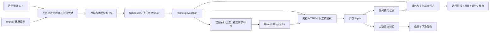

# 远程 Agent 接入契约（阶段 D2，工程验收完成）

当前已实现严格协议契约、受控 HTTPS 传输、持久注册目录、加密凭据管理、注册管理 API、Worker 健康探测、发现和入队版本冻结，以及远程成员执行、固定报价结算、有界状态查询和尽力取消。新增迁移包括 `0017_remote_agent_registry`、`0018_fixed_remote_charges` 和 `0019_remote_agent_calls`。本次提交包含混合团队、真实 HTTPS 和跨 Worker PostgreSQL 验证；阶段 D 工程验收已完成，C5 真实模型效果评估仍待完成，不能将代码提交视为生产放行。首个适配器使用平台定义的 `agent-platform-task-v1`，不宣称兼容 A2A 或其他厂商协议；其他协议需另加适配器并完成相同验收。

## 注册与版本

远程目录与内部 Agent 目录分开存储。远程注册应关联一个同租户的逻辑 Agent 发布版本，使现有团队仍按成员 ID、版本和任务契约选择候选。发布版本固定远程描述摘要、报价标识、契约和允许的端点集合；修改凭据引用、端点、报价或能力需生成新版本，不得静默改变已入队任务。健康与启停状态独立于不可变描述，在发现和每次发送前复核。

`RemoteDescriptor` 包含外部 Agent 标识、版本、名称、能力、TaskContract、报价标识、最大费用、USD 币种、超时上限及幂等、状态查询和取消能力。首个协议要求支持稳定幂等键及按请求标识查询；不支持时拒绝登记为可执行成员。声明的能力不等于回答质量保证。跨组织授权不通过此目录隐式授予。

端点与凭据引用属于管理元数据，不向规划模型传递。凭据应单独加密保存、只写不回显，读取仅限执行服务；不能复用模型提示词或普通 Agent 描述存放密钥。创建、修改、停用、探测和凭据变更要求当前组织管理权限并留审计。

## 传输边界（已实现基础模块）

仅允许管理员在平台配置中明确列出的 HTTPS origin；域名和端口必须精确匹配。请求 URL 不允许嵌入用户名、密码、查询、fragment、转义路径或路径穿越。解析 DNS 后校验全部地址，拒绝本地、内网、链路本地、保留地址及 IPv6 转换地址。连接固定到校验过的 IP，证书验证和 SNI 仍使用原始域名，防止连接时重新解析 DNS。使用系统默认证书验证，不读取代理环境配置。

传输不自动重试、不跟随跳转。请求和响应各不超过 1 MiB，单次网络请求最多六十秒；完整远程任务另受冻结的任务截止时间限制。响应必须是 JSON，拒绝重复键和非有限数字。发送 POST 前必须调用执行授权回调；该回调位于 TLS 连接完成后、发送请求内容前，供运行时再次校验租约、权限、取消与持久发送标记。

固定路径：

| 方法与路径 | 语义 |
| --- | --- |
| `GET /health` | 校验远程身份、描述摘要与健康状态，不取得执行权限 |
| `POST /tasks` | 提交一个已准入的任务；必须使用持久化的 request_id 和幂等键 |
| `GET /tasks/{request_id}` | 只读查询已提交任务的状态、完整输出和费用证据 |
| `POST /tasks/{request_id}/cancel` | 尽力取消远端任务，不等同于未执行或零费用 |

路径追加到登记的基础路径，不能由模型输出或远端响应覆盖。请求携带 Bearer 凭据；失败信息不回显凭据或远端原始错误正文。

## 请求与证据（已实现类型契约）

`RemoteRequest` 仅传递分配给该成员的任务目标、显式输入及其摘要、固定的外部 Agent 身份与版本、描述摘要、报价标识、费用上限和首次准入时冻结的截止时间。不传递其他成员的系统提示、私有工具轨迹、完整主会话或平台身份凭据。任务输入仍按本地 TaskContract 校验。

`RemoteStatus` 包含 request_id、远端任务标识、状态和两个独立的可选证据：

- `RemoteResult`：完整输出值及内容摘要；本地必须再次校验任务输出契约后，才能确认成果和解锁下游。
- `RemoteFee`：稳定费用凭据标识、关联请求和报价、USD 金额以及最终确认标记；不包含完整输出，不得据此推断任务可恢复。

`running`、`succeeded`、`failed`、`cancelled`、`not_found` 是远端状态。仅返回 `succeeded` 但没有完整输出时，本地不能宣布任务成功。返回 `cancelled` 但没有最终费用凭据时，费用仍待确认。查询返回 `not_found` 不证明之前的 POST 没有执行，不自动重发。输出与费用凭据均应幂等接收；同一标识给出不同内容必须转为冲突处理。

## 开发任务与当前状态

1. **D2.1 目录与凭据（已完成工程验收）**：新增不可变远程版本、受控端点、凭据引用和健康记录，包含迁移、RLS、服务权限及租户关闭清理逻辑。组织级注册/读取/停用/健康探测 API 已接入，凭据加密且不回显。注册幂等、版本更新、权限与跨租户引用已有测试；实际 PostgreSQL 验证 API 密文只写、Worker 同租户解密与探测、跨租户读取隔离和端点凭据复合外键。租户关闭的实际清理阶段已验证密文、描述及端点删除，不以停用标识代替删除敏感内容。
2. **D2.2 发现与冻结（已完成工程验收）**：健康 TTL、当前可用性和发布契约已纳入发现；团队入队固定远程版本和端点白名单。Worker 独立探测池通过租约和 fence 防止过期探测恢复已撤销的健康状态。运行时在 TLS 连接完成、请求发送前重新检查当前资格、租约、取消状态和费用预占，发现结果不能绕过授权。
3. **D2.3 执行与计费（已完成工程验收）**：`BillingService.reserve_fixed` 和 `settle_fixed` 已支持冻结报价、原子钱包预占、租户/用户额度、平台供应商成本上限和独立费用证据；远程成员已接入同一个任务/Execution、根预算与调用次数，以及运行详情、用量、统计和导出的费用投影。等待容量或健康不产生外部请求和费用预占。
4. **D2.4 未知结果与取消（已完成工程验收）**：提交前保存完整意图和稳定标识，发送后未知只做有界状态查询。完整输出和最终费用分别确认；撤权或根取消后不得继续提交任务，远端取消只能尽力执行，已确认费用仍计入根运行。
5. **D2.5 联合验收与文档（已完成工程验收）**：使用隔离的 HTTPS 服务及确定性用例验证注册→健康发现→混合内部/远程团队→成果汇总，以及状态补证、凭据轮换、停用、未知 POST、错误报价、取消和跨租户攻击。现有传输单元测试不能替代该端到端验收。

C5 的真实模型效果评估完成前，`PLATFORM_REMOTE_AGENTS_ENABLED` 保持默认关闭，`PLATFORM_REMOTE_AGENT_ALLOWED_ORIGINS` 默认为空数组。Compose、Kubernetes、Helm API/Worker 配置已透传这两个参数；白名单采用 JSON 数组。开启后可执行健康探测及远程团队任务；生产启用仍以 C5 放行为前提。关闭执行开关不会停止既有调用的后台费用补证；补证仍受端点白名单与有效凭据约束。

## 金额结算基础与人工处置

`billing_reservations.charge_kind` 区分既有 `tokens` 和新增 `fixed`。既有记录迁移后保持 `tokens`；固定报价保存 `quote_id`，使用注册版本标识作为账务主体（存于兼容字段 `model_id`），不创建虚构模型或模型部署。Token 字段为零，金额直接按最多十二位小数计算。模型结算入口不能结算固定报价，远程费用入口也不能结算模型调用。

固定报价准入同时预占客户钱包与平台供应商成本预算，缺少平台成本预算时拒绝；任一余额、额度或授权检查失败时整笔事务回滚。供应商成本记录使用 `charge_kind=fixed`，不填写模型部署或模型价格版本。远程费用凭据以 `source=remote_agent`、`quality=remote_final` 保存；核对请求标识、冻结报价、最终确认布尔值和金额上限后，才更新客户账本与供应商成本。已发送但未取得有效最终费用的调用保留预占；同一回执重投不重复扣款，改写回执或超报价保留冲突证据。

人工核实使用平台财务接口 `POST /api/v2/platform/tenants/{tenant_id}/billing/reservations/{call_id}/resolve`，要求当前平台财务权限、`Idempotency-Key`、`action` 和 `reason`。固定费用确认使用 `fixed_amount`，不得同时传 Token 用量，金额不能超过冻结报价。`write_off` 不传金额或 Token：释放客户预占，但按报价上界计入平台供应商成本，保留人工处置审计。费用确认或核销都不能代替任务完整输出证据，也不能授权重新发送远程任务。

验证入口：`tests/test_remote_agent_billing.py` 的 13 项金额测试覆盖精度、重复回执、类型隔离、冲突证据、预占回滚、跨租户预算竞争、人工确认和核销；`test_api.py` 验证平台财务接口及普通成员拒绝。`test_postgres_isolation.py` 中 `test_remote_fixed_fees_use_worker_permissions_and_tenant_rls` 与 `test_remote_registry_separates_api_secrets_and_worker_discovery` 验证实际服务角色。本次提交前后端回归共运行 534 项，结果通过，其中 25 项按环境条件跳过；隔离 PostgreSQL 组合验证 12 项通过，包含不同 Worker 执行混合团队及财务投影。前端构建、Ruff 和 API 契约同步检查通过。`test_remote_agent_execution.py` 覆盖混合团队、未知 POST 后查询、输出与费用独立、撤权、预算、取消及恢复；其中真实 HTTPS 测试验证服务收到 POST 后断开连接，客户端仅通过原请求标识查询完成。上述测试不替代 C5 的真实模型质量、成本及延迟评估，也不表示所有故障组合已验收。

## 当前运行链路与恢复边界

`remote_agent_calls` 记录执行归属、冻结端点、原始截止时间、查询次数和补证租约，敏感输入与输出仍保存在加密日志。发送状态先持久化，再发送请求；发送后连接异常或查询返回 `not_found` 都不触发任务重投。恢复使用原请求标识，只查询原端点。

执行中的状态查询累计最多 20 次，且受原始任务截止时间约束。根运行或成员执行结束后，独立补证池最多领取 12 次，间隔至少 30 秒，并以租约和 fence 隔离过期 Worker；尽力取消只提交一次。费用未确认时保留预占，次数耗尽后转人工处置。后台补证只能更新费用和远端状态，不能发布成果或恢复已结束的成员执行。

## 阶段 D 最终工程验收

完整后端工程门禁运行 548 项，0 失败、0 错误、0 跳过；覆盖真实 PostgreSQL 17 服务角色与冻结迁移权限、Redis 和 Helm。远程执行专项 28 项，含 6 项独立进程直接退出与 4 项真实 HTTPS 场景，验证错误报价不阻断已确认输出恢复、取消后不发布成果、关闭功能后继续费用补证、原标识和截止时间不变。金额投影与 CSV 在 SQLite 和实际 PostgreSQL 维护/API 角色下核对一致。

要求、实现和测试映射以及机器报告见 [阶段 D 工程验收记录](validation/stage-d-acceptance.md)。本节更新前的 534 项回归及 12 项数据库专项记录是较早的检查点；最终门禁以上述 548 项无跳过结果为准。C5 真实模型质量、成本和延迟评估仍未执行。
